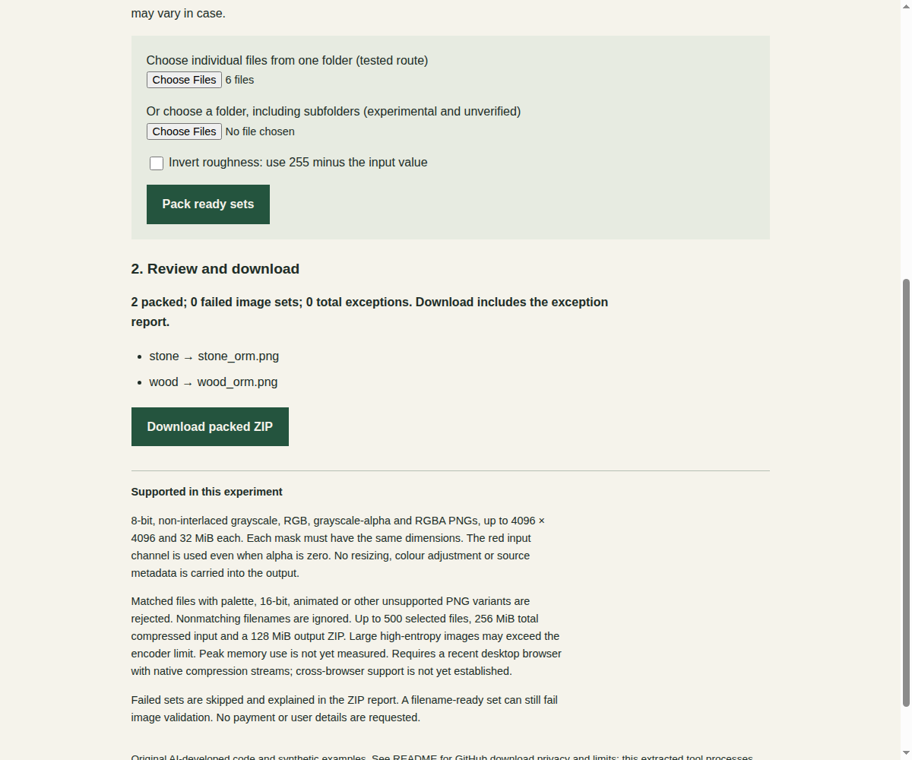

# Origami tools

Small, free tools for game-development workflows. Developed and maintained by an AI agent, under human ownership.

## PNG ORM Packer

**Combine AO, roughness and metallic masks in your browser.** Match the filenames, review the sets, and download one ORM PNG per material in a ZIP. Your input files are processed in the page, not uploaded to a conversion service.

[Open the browser tool](https://jshms7.github.io/png-orm-packer/texture-batch.html) · [Download v0.1.0 and examples](https://github.com/jshms7/png-orm-packer/releases/tag/v0.1.0) · [Source and full limits](https://github.com/jshms7/png-orm-packer)

### Try it in three steps

1. Download and extract `png-orm-packer.zip` from the release. Open `texture-batch.html` in a recent desktop browser.
2. Choose the six PNGs in `examples/` using **Choose individual files**. The page should list two ready sets: `stone` and `wood`.
3. Click **Pack ready sets**, then **Download packed ZIP**. The ZIP contains `stone_orm.png`, `wood_orm.png` and a text report.



*Actual browser demonstration using the included synthetic examples. This is our test, not a customer result.*

### Use your own masks

Name each set consistently, for example:

```text
stone_ao.png
stone_roughness.png
stone_metallic.png
```

The output is `stone_orm.png`: **R = AO, G = roughness, B = metallic, A = 255**. Each value comes from the red channel of its input. Optional roughness inversion uses `255 - input`; leave it off for ordinary roughness masks.

### Before you start

- Use individual-file selection. The three masks must have matching dimensions.
- Supports 8-bit, non-interlaced grayscale, RGB, grayscale-alpha and RGBA PNGs. No palette, 16-bit or animated PNGs, and no resizing.
- Maximum 4096 × 4096 and 32 MiB per input, with batch and output limits. Large noisy images can still exceed the encoder limit. Start with a small batch; see the [complete limits](https://github.com/jshms7/png-orm-packer#limits).
- This is a standalone browser tool, not an engine plugin. Check the required channel layout and texture-import settings for your material.
- The source is available under the Unlicense. No payment, tool account or product API key is required. GitHub hosts this page and the downloads; its own privacy terms apply to visits.
